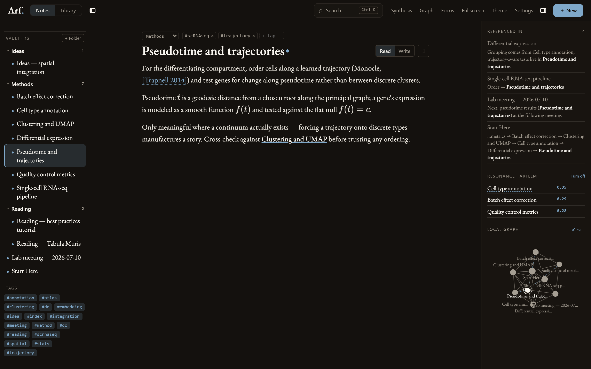

# Arf

Desktop Markdown notebook for scientists and coders: linked notes, LaTeX math, code, a reference library, a document reader and optional on-device embeddings for finding related notes.

[Download](https://github.com/tunabirgun/arf/releases/latest) · [Documentation](https://tunabirgun.github.io/arf/) · [Changelog](CHANGELOG.md)



## Use

Choose a vault folder at first launch. Notes stay Markdown files, connected by `[[wikilinks]]`, backlinks, tags and an interactive graph in which linked notes follow a dragged note. The Library manages references and exports citations; the side reader opens PDF, EPUB and article content next to a note. Markdown files, folders (including Obsidian vaults), ZIP archives and BibTeX, RIS or CSL-JSON references can be imported. Notes export as Markdown, HTML or PDF, the vault as a ZIP archive, and the whole workspace backs up to a single `.arf` file.

Optional local embeddings support related-note suggestions and synthesis. No model ships with the app: Settings → Connection suggestions downloads one on request. The default is [ArfLLM](https://huggingface.co/tunabirgun/ArfLLM) (English; the all-MiniLM-L6-v2 weights in an export prepared for Arf), and [ArfLLM_Multi](https://huggingface.co/tunabirgun/ArfLLM_Multi) is a multilingual model fine-tuned for scientific text; their model cards report how each was evaluated.

## Data and network use

Notes and embedding computation stay on the device. Model downloads contact Hugging Face, and the model runtime is fetched from jsDelivr and checked against hashes recorded at build time; reference searches and open-access document retrieval contact their external sources. A vault placed in a third-party sync folder is synchronized by that provider under its own terms.

Back up the whole workspace, including attachments. A sync conflict can produce a separate conflict copy for review, and importing a workspace merges by ID without overwriting existing notes. Read [Your data](https://tunabirgun.github.io/arf/data.html) before moving or synchronizing a vault.

## Build from source

Requires Node.js 20 or later (the repository pins Node 24 in `.nvmrc`), Rust and the [Tauri prerequisites](https://tauri.app/start/prerequisites/); Windows also needs the MSVC C++ build tools.

```bash
npm install
npm run tauri dev     # development build
npm run tauri build   # installers in src-tauri/target/release/bundle/
npm test              # unit tests
npm run test:e2e      # end-to-end tests
```

See [CONTRIBUTING.md](CONTRIBUTING.md) for development, [SECURITY.md](SECURITY.md) for vulnerability reports and release verification, and [ROADMAP.md](ROADMAP.md) for planned work.

## License

[MIT](LICENSE) © Tuna Birgün
